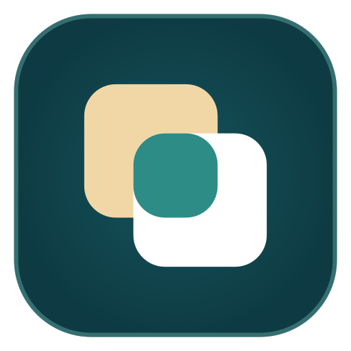

<div align="center">



# Tawam · توأم

**Your Android phone and your PC, working as twins.**

Notifications, messages, calls, clipboard, files, photos, screen mirroring and
phone apps in windows, between Android and Linux or Windows. Local-first,
end-to-end encrypted, no account and no cloud.

</div>

> [!IMPORTANT]
> **Tawam is a modified version of [NectarLink](https://github.com/thtbee/nectarlink)**
> by Bee and the NectarLink contributors. It is not the official NectarLink and
> is not endorsed by that project. Both the **desktop app** and the **Android
> app (APK)** are changed: the self-updaters are removed, LocalSend
> compatibility is HTTPS-only, and the app is renamed with a new logo and
> Android package ID. See **[CHANGES-TAWAM.md](CHANGES-TAWAM.md)** for the full list.

## Download

From [Releases](https://github.com/MartinDean07/tawam/releases/latest):

| | File | Needs |
|---|---|---|
| **Linux (x86_64)** | `tawam_<version>_amd64.deb` | Ubuntu 24.04+, Debian 13, Linux Mint 22+ (glibc 2.39+) |
| **Android** | `Tawam-<version>-android.apk` | Android 8.0 or newer |

Check downloads against `SHA256SUMS.txt` in the release. The APK is signed with
the Tawam key; its certificate fingerprint is in the release notes.

```bash
sudo apt install ./tawam_<version>_amd64.deb
```

Tawam does not update itself. Install a newer release the same way.

On Android, allow your browser or file manager to install apps when asked, or
install from a PC with `adb install Tawam-<version>-android.apk`. Tawam installs
next to NectarLink; the two can't pair with each other's pairing links.

## What it does

**Stay on top of your phone**
- **Notifications** on the PC, with replies, actions, Live Updates (progress,
  timers, deliveries) and a **Copy code** button for one-time codes. Clear on
  one side, cleared on the other.
- **Messages**: SMS and MMS conversations plus chats from RCS, WhatsApp,
  Telegram, Signal and other apps in one inbox. Reply, send pictures, start
  new conversations.
- **Calls**: see who's calling, answer, decline or hang up from the PC, call
  any number or contact through the phone, and browse recent calls.

**Move things between devices**
- **Clipboard**: copy on one device, paste on the other, with optional
  encrypted history. Passwords from password managers are never sent, and
  one-time codes are never kept in the history.
- **Files and folders** both ways at Wi-Fi speed, with resume after a dropped
  connection, **Send to** in File Explorer, and the phone's storage in File
  Explorer.
- **Photos**: the phone's camera roll, screenshots and albums on the PC.
- **Handoff**: links, maps and videos (at the same timestamp) open on the
  other device.

**Use your phone from the PC**
- **Screen mirroring** at up to 60 frames a second with the phone's sound,
  screenshots and recording.
- **Apps**: open any phone app in a window of its own on the PC, with its own
  taskbar icon, running beside whatever the phone shows.
- **Type on the phone** with the PC keyboard, without mirroring.
- **Phone controls** on the PC: Do Not Disturb, ringer, volume, flashlight,
  brightness, Wi-Fi and Bluetooth.

**Use your PC from the phone**
- **Touchpad, air mouse, keyboard, voice typing and presentation remote.**
- **Deck**: a Stream Deck style grid of buttons for the PC (media, shortcuts,
  apps, OBS Studio, commands), with live volume and mute.
- **Lock, sleep and wake** the PC.

**Camera and sound**
- **Phone as a webcam** in Zoom, Teams, Meet, OBS and the Camera app.
- **Continuity Camera**: take a photo or scan a document with the phone and
  have it on the PC's clipboard.
- **Phone as a speaker** for the PC's sound, and a **voice recorder** that
  saves straight to the PC.

**And more**: media controls both ways, battery alerts, Find my device, a
searchable **Timeline** of everything that moved, a **Command Palette**
(`Ctrl+Alt+Space`), a slide-out **Shelf**, a home-screen widget, and a
**Connection Doctor** that finds and fixes what keeps devices from connecting.
Four themes, **Hive**, **Bloom**, **Glass** and **Graphite**, each in light
and dark.

### Platform support

| Feature | Windows | Linux | macOS (Preview) |
|---|---|---|---|
| Pairing & mutual TLS | Yes | Yes | Yes |
| Files & folder transfer | Yes | Yes | Yes |
| Photos browser & download | Yes | Yes | Yes |
| Continuity Camera | Yes | Yes | Yes |
| Calls & SMS viewer | Yes | Yes | Yes |
| Phone quick toggles & volume | Yes | Yes | Yes |
| Clipboard text & image sync | Yes | Yes | Yes (two-way text, incoming photo) |
| System notifications | Yes | Yes | Yes (system banners) |
| Phone screen mirroring | Yes | Yes | Not yet (in development) |
| Screen recording (MP4) | Yes | Yes | Not yet |
| PC audio stream / phone mic | Yes | Yes | Not yet |
| Phone as webcam | Yes | Yes (with v4l2loopback) | Not yet |
| Phone storage in the file manager | Yes | Yes | Not yet |


## Private by design

- **Local-first.** Devices talk directly over your network or a USB cable.
  Nothing goes through a server, and there's no account.
- **End-to-end encrypted.** Every connection is QUIC with TLS 1.3, authenticated
  with device keys exchanged when you pair. Keys are protected by Windows DPAPI
  and the Android Keystore.
- **You decide what's shared.** Each paired device has its own feature
  switches. Remote control of the PC, shell commands and phone storage are off
  until you allow them.
- **The only internet traffic** is the update check against GitHub Releases
  (which you can turn off), and, if you turn it on, **Connect over mobile
  data**, which relays encrypted traffic it can't read.

Details: [Privacy and security](docs/guide/privacy-and-security.md) and the
[security model](docs/technical/security-model.md).

- **No self-updater.** Tawam never downloads or installs anything by itself.

## Building from source

See [docs/technical/building-and-testing.md](docs/technical/building-and-testing.md).
On Linux the release is built with Qt 6.12 and the scripts in
`desktop/packaging/linux/`; the Android app with `./gradlew assembleRelease` in
`android/`.

## License

- Windows and Android apps, CLI: [GPL-3.0-or-later](LICENSES/GPL-3.0-or-later.txt),
  with an [app-store exception](LICENSES/APP-STORE-EXCEPTION.md)
- Core libraries: [MPL-2.0](LICENSES/MPL-2.0.txt)
- Protocol specification and documentation: [CC BY 4.0](LICENSES/CC-BY-4.0.txt)

See [LICENSE](LICENSE) for which license applies where. The NectarLink name and
logo are covered by the [trademark policy](TRADEMARKS.md).


The NectarLink name and logo belong to the NectarLink project and are not used
by Tawam (see `TRADEMARKS.md`, which describes the upstream project's policy).
